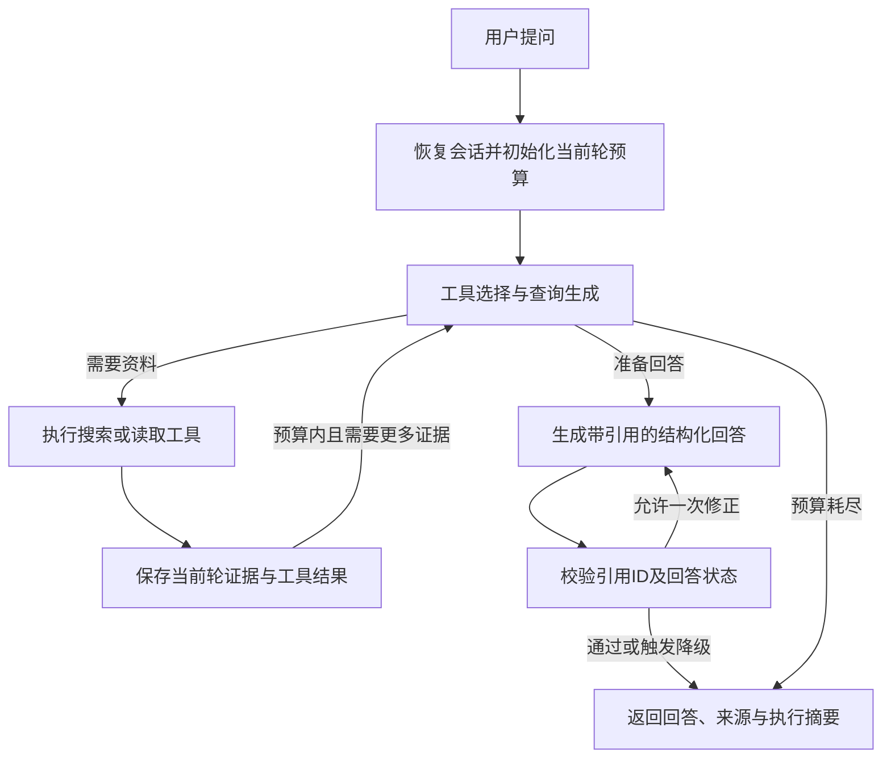

# DevDocs Agent 项目计划书

版本：1.0　｜　编写日期：2026年10月30日　｜　定位：第一个 Agent 入门项目

本计划基于对上游源代码的阅读制定。本次交付是实施计划，尚未替你安装项目、调用付费模型或完成运行验证。下面的新增文件、接口、命令及指标，除明确标为“上游已有”的内容外，均为待实现设计。

建议先读第1、3、16、17节，确定目标、底座和第一步；其余内容在做到对应模块时查阅。第一天只执行第1阶段的准备任务。

## 1. 项目决定与完成后的样子

**基于 `langchain-ai/retrieval-agent-template`，开发一个面向 FastAPI 官方文档的技术问答 Agent。**

项目名称：**DevDocs Agent：支持工具调用、证据引用与多轮追问的技术文档助手**。

目标用户是学习或使用 FastAPI 的开发者。用户用中文提问，系统检索固定版本的官方文档，按需读取原文和示例代码，给出带来源的解释；遇到范围外问题、证据不足或工具失败时，能够说明限制并结束任务。

完成后，你应该能演示：

1. 问“FastAPI 的依赖注入如何使用”，得到解释、引用和示例。
2. 继续问“如果依赖使用 yield 呢”，系统能够结合上文检索。
3. 问“测试时怎么临时替换这个依赖”，系统选择合适工具，定位覆盖依赖的文档与代码。
4. 问知识库没有覆盖的问题，系统澄清或说明当前资料不足。
5. 查看一次请求的检索片段、工具调用、耗时和 Token 使用情况。
6. 在相同问题上切换基础 RAG 与改进 Agent，比较结果与成本。

**范围固定：一个框架、一份文档快照、三个只读工具、一个 Agent、一个简单界面。** 初期不做小说数据、不做模型训练、不做任意代码执行，也不引入复杂的多 Agent 协作。

建议工期为 **4～6周，每周约10～15小时**。这是基于能够阅读基础 Python 的估计；如果异步编程、HTTP 和 Git 都需要补课，可延长至6～8周。按验收推进，不必为了日期跳过理解环节。

## 2. 与实习岗位逐项对应

这份岗位同时涉及应用、评测和基础设施。第一个项目优先建立应用开发能力，训练与异构计算留给后续专项。

| 岗位方向 | 本项目对应内容 | 能展示的证据 | 覆盖程度 |
| --- | --- | --- | --- |
| 业务方向的 Agent 应用开发 | 为技术文档问答定义用户、任务、失败行为和演示流程 | 产品说明、可运行演示、用户问题样例 | 直接覆盖方法，业务领域不同 |
| Agent 架构与流畅对话服务 | 离线索引与在线服务分离，状态管理、工具路由、请求预算 | 架构图、模块代码、请求轨迹 | 入门级覆盖；不宣称亿级服务能力 |
| Prompt、工具编排、RAG及核心开发 | 查询改写、混合检索、三个工具、有界循环、证据回答 | 核心代码、对比实验 | 重点覆盖 |
| 开发规范、评测与质量控制 | 工具返回协议、Prompt版本、固定评测、失败分类 | 规范文档、回归脚本、评测报告 | 重点覆盖 |
| 幻觉、长上下文、多轮、工具可靠性 | 引用校验、上下文预算、会话持久化、超时与有限重试 | 对话用例、故障测试、失败分析 | 应用层覆盖；不等于突破模型长上下文推理能力 |
| 技术调研与引入 | 比较向量检索与混合检索、固定流程与工具循环 | 两份简短技术选型记录 | 可完成覆盖 |
| 机器学习、异构计算、推理与训练基础设施 | 第一版仅做模型服务适配、用量统计与并发限制 | 模型接口、配置和性能记录 | 部分相关；GPU、训练和异构计算需另做专项 |

因此，本项目适合作为投递该岗位的第一份应用项目。简历中描述自己实际实现和验证的能力，不把岗位上的规模指标写成项目已有成果。

## 3. 上游项目现在到底有什么

实施基线固定到上游提交：

`1d0c84cf19a60278f2238ead42e5f9189191cfd4`

该提交在本次核查时对应上游 `main`。固定提交能避免学习期间上游更新导致代码和计划错位。[上游提交](https://github.com/langchain-ai/retrieval-agent-template/commit/1d0c84cf19a60278f2238ead42e5f9189191cfd4)

| 上游已有文件 | 当前实际作用 | 改造方向 |
| --- | --- | --- |
| `src/retrieval_graph/graph.py` | `generate_query → retrieve → respond` 固定流程；首轮直接用原问题，后续轮调用模型改写检索问题 | 保留作基础 RAG 对照，另建 Agent 图 |
| `index_graph.py` | 给传入文档加 `user_id`，写入检索后端 | 接入解析后的文档块，增加稳定ID和可重复索引 |
| `retrieval.py` | 构建 Embedding 和 Elasticsearch、Pinecone、MongoDB 检索器 | 增加本地 Chroma 适配、明确写入/检索接口、混合检索 |
| `state.py` | 消息、历史查询和当前检索文档；消息使用 reducer 合并 | 增加 Agent 状态、当前轮预算与证据集合 |
| `configuration.py` | 用户、模型、检索后端及 Prompt 配置；读取 `configurable` | 增加本地存储、语料快照、预算和运行模式 |
| `prompts.py` | 简单回答 Prompt 和检索问题生成 Prompt | 保留基线版本，增加改写、工具选择及证据回答规范 |
| `utils.py` | 读取消息、格式化文档、加载聊天模型 | 保留基础功能，拆出引用、Token和模型适配模块 |
| `langgraph.json` | 导出 `indexer` 与 `retrieval_graph` 两个图 | 新增 `devdocs_agent` 图，不删除原入口 |
| `tests/unit_tests/test_configuration.py` | 简单配置构造检查 | 增加数据、工具、状态和检索的行为验证 |
| `tests/integration_tests/test_graph.py` | 文档写入、问答和不同用户配置的集成用例 | 保留参考；为本地存储和 Agent 增加集成用例 |

上述判断来自实际文件，而非仅依据 README：[主流程](https://github.com/langchain-ai/retrieval-agent-template/blob/1d0c84cf19a60278f2238ead42e5f9189191cfd4/src/retrieval_graph/graph.py)、[检索模块](https://github.com/langchain-ai/retrieval-agent-template/blob/1d0c84cf19a60278f2238ead42e5f9189191cfd4/src/retrieval_graph/retrieval.py)、[图入口](https://github.com/langchain-ai/retrieval-agent-template/blob/1d0c84cf19a60278f2238ead42e5f9189191cfd4/langgraph.json)。

开始时特别注意四点：

- 当前真实目录是 `src/retrieval_graph/`。README部分示例写的是 `retrieval_agent`，实施时以代码为准。
- 模板没有负责下载、清洗、按标题切分 FastAPI 文档，需要补一条离线导入流程。
- 消息字段能接收历史，不代表已经实现了你自己的持久化会话服务。
- 当前代码声明了 `context_schema`，配置读取仍使用 `RunnableConfig.configurable`。新 Agent 统一从运行时 context 读取业务配置，`thread_id` 留在运行配置里；基线入口保留兼容适配并验证。不要假定声明 schema 后所有配置就会自动到达节点。[原配置代码](https://github.com/langchain-ai/retrieval-agent-template/blob/1d0c84cf19a60278f2238ead42e5f9189191cfd4/src/retrieval_graph/configuration.py)、[LangGraph运行时示例](https://github.com/langchain-ai/langgraph/blob/main/libs/langgraph/langgraph/runtime.py)

## 4. 从底座到三个可交付版本

| 版本 | 完成后的表现 | 必须完成的工作 | 暂缓内容 |
| --- | --- | --- | --- |
| V0：理解模板 | 能解释节点、状态、配置、索引与回答如何连接 | 阅读原代码、环境验证、测试配置、一次最小图调用 | 界面、复杂检索 |
| V1：可用 RAG | 能针对本地官方文档回答并显示来源 | 文档脚本、本地索引、基础问答、最小命令行入口 | 工具自主选择、重排序模型 |
| V2：可控 Agent | 能选择工具、处理追问、在预算内结束 | 工具循环、状态、证据校验、故障处理与持久化 | 多 Agent、自动写代码 |
| V3：可展示与评估 | 有简单界面、结果对比和复现说明 | 混合检索、30条评测、演示、README与报告 | 大规模部署、训练基础设施 |

V1是第一个小成果；完成V2和V3后，再作为较完整的求职项目展示。重排序是V3后的可选实验，不作为第一版完成条件。

## 5. 统一技术选型

| 部分 | 本计划选型 | 选择理由 |
| --- | --- | --- |
| 语言与依赖 | Python 3.11或3.12，uv与锁文件 | 沿用Python生态，固定可复现环境 |
| 编排 | LangGraph | 延续模板，直接学习节点、边、状态和检查点 |
| 聊天与Embedding | 可访问的模型API，分别配置 | 开发起步无需GPU；能分开理解生成与向量化 |
| 向量存储 | 本地持久化Chroma | 省去外部数据库部署，适合少量文档；需要自己新增适配 |
| 关键词检索 | `rank-bm25`，本地构建 | 小语料便于看清分词、关键词与排序的影响 |
| 融合 | RRF排序融合 | 不必直接混合量纲不同的相似度分数 |
| 会话持久化 | LangGraph SQLite检查点 | 单机演示够用，能练习跨请求与重启后的状态恢复 |
| HTTP服务 | FastAPI | 提供独立服务入口，也与学习资料保持一致 |
| 演示界面 | Streamlit | 用少量界面代码展示回答、引用和工具轨迹 |
| 追踪与评测 | 本地JSONL与pytest | 不要求额外开通追踪平台，便于查看每个字段 |

**本地Chroma是本计划新增功能，原模板没有内置。** 上游的其他存储适配先保留，不要求同时部署和验证。基线比较使用“原模板固定流程＋必要的本地适配”，报告中据实写明。

Chroma及其LangChain集成有现成实现可以调用，自己的工作重点是适配、数据设计和检索行为。[Chroma项目](https://github.com/chroma-core/chroma)、[LangChain Chroma集成](https://github.com/langchain-ai/langchain/tree/master/libs/partners/chroma)

模型选择先检查：支持工具调用、能稳定返回结构化参数、中文提问效果可接受、API可用。Embedding另外检查中英跨语言检索、向量维度、输入长度及接口兼容性。模型名通过配置填写；配置使用的模型要实际试通，不依赖上游历史默认模型名。

配置的职责也分开：`.env`保存实际服务密钥、模型名及必要的服务地址，`configs/`保存不含秘密的语料、检索和预算参数。新增配置加载代码，将这些字段显式传给模型或存储适配器；仅在`.env`里写入一个新变量，不会让上游代码自动支持该服务。聊天和Embedding分别用一条最小请求验收，再进入完整问答流程。

## 6. 目标架构与一轮请求

离线流程：

`固定文档快照 → 读取Markdown与引用代码 → 清洗 → 标题切分 → 元数据与稳定ID → Chroma与BM25索引`

在线流程：



以“测试时如何替换依赖，并找到官方示例”为例：

1. 读取本会话已讨论的FastAPI依赖信息。
2. 模型调用 `search_docs`，检索 `dependency_overrides` 相关资料。
3. 搜索结果返回文档ID、章节、摘要和关联的示例ID。
4. 模型调用 `read_example` 读取被允许的官方代码。
5. 回答说明做法，引用本轮实际读取过的文档与示例。
6. 服务返回工具名称、状态、耗时、引用、Token统计。

同一问题的基础RAG模式只执行固定的查询生成、一次向量检索和回答。Agent允许多步查找，因此也可能更慢；复杂度和收益要一起测量。

## 7. 数据准备：自动读取现成资料

### 7.1 固定来源与范围

首版使用FastAPI官方仓库的英文文档，支持中文提问。英文资料与中文问题的跨语言差异要纳入检索设计，不同时导入多种语言造成重复。

建议锁定本次核查的资料提交：

`79cab5bed28b24d92c185d236feb33f5783dfeb3`

这是文档快照标识，不自动代表某个FastAPI发布版本。若后来改用release tag，应另记tag与commit的对应关系。[资料提交](https://github.com/fastapi/fastapi/commit/79cab5bed28b24d92c185d236feb33f5783dfeb3)

第一批只导入下列10篇文档及其引用的示例文件：

```text
docs/en/docs/tutorial/body.md
docs/en/docs/tutorial/background-tasks.md
docs/en/docs/tutorial/testing.md
docs/en/docs/tutorial/dependencies/index.md
docs/en/docs/tutorial/dependencies/classes-as-dependencies.md
docs/en/docs/tutorial/dependencies/sub-dependencies.md
docs/en/docs/tutorial/dependencies/global-dependencies.md
docs/en/docs/tutorial/dependencies/dependencies-in-path-operation-decorators.md
docs/en/docs/tutorial/dependencies/dependencies-with-yield.md
docs/en/docs/advanced/testing-dependencies.md
```

10篇足够验证端到端流程，之后按失败案例扩到20～30篇。脚本应逐个验证文件存在，不悄悄跳过缺失文件后继续宣称导入成功。

### 7.2 自动化脚本应做什么

新增 `scripts/prepare_corpus.py`：

1. 从本地FastAPI仓库读取允许列表，检查commit。
2. 提取标题和正文，保留与答案有关的提醒、表格及代码。
3. 解析FastAPI文档中的代码引用标记，读取对应 `docs_src/` 文件。
4. 输出规范化文档、示例注册表、来源清单和导入统计。

FastAPI的Markdown确实包含外部代码引用，例如依赖教程将代码放在 `docs_src/dependencies/` 下。[官方源文件示例](https://github.com/fastapi/fastapi/blob/79cab5bed28b24d92c185d236feb33f5783dfeb3/docs/en/docs/tutorial/dependencies/index.md)

引用中的相对路径需要按仓库文档构建约定映射到根目录的 `docs_src/`，不能简单拼接当前Markdown所在目录。第一版只支持受控的代码引用格式：将已知 `../../docs_src/` 前缀映射到仓库根的 `docs_src/`，检查文件存在且解析后的路径位于允许目录。只读取文本，不执行文档中的指令或代码。

新增 `scripts/build_index.py`：读取规范化输出，切块、计算Embedding、写入Chroma，同时生成相同语料范围的BM25索引。不要让用户每次启动界面时都重建索引。

### 7.3 切块与元数据

先按Markdown标题分节，再把超长节切成约700 tokens的小块，重叠约100 tokens。这些只是起始参数；短文档不强制凑长，代码块尽量保持完整。

文档记录至少包含：

```json
{
  "corpus_id": "fastapi-en",
  "source_commit": "79cab5bed28b24d92c185d236feb33f5783dfeb3",
  "doc_id": "由commit和相对路径确定的稳定ID",
  "chunk_id": "由文档ID、切块配置、位置和内容确定的稳定ID",
  "source_path": "docs/en/docs/advanced/testing-dependencies.md",
  "source_url": "指向同一commit下文件的GitHub链接",
  "heading_path": "Testing Dependencies with Overrides > Use the app.dependency_overrides attribute",
  "language": "en",
  "content_hash": "内容摘要",
  "content": "片段正文"
}
```

规范化JSONL可以包含列表；写入向量库前将metadata规范为所用适配器支持的类型。示例与文档的多对多关系保存在独立注册表中，不直接塞入未经验证的复杂metadata。

索引需要支持：重复导入同一快照不增加重复条目；修改切块或Embedding模型时创建新索引命名空间；记录模型、维度、切块版本、文档数和块数。切换Embedding模型或维度时重新建索引，不能复用旧向量。

### 7.4 数据准备的验收

- 给定同一commit和配置，连续运行两次，文档ID及块ID一致，条目数不增长。
- 抽查5个片段，标题、正文、代码和来源正确。
- 来源链接指向固定commit，能找到对应原文。
- 使用 `Depends`、`yield`、`dependency_overrides` 等问题能找到相应资料。
- 导入结束打印文档数、示例数、块数、耗时、失败清单及Embedding用量。

## 8. 检索改进：每增加一层都解释得清楚

### 8.1 先建立纯向量基线

新增本地存储适配，让原流程能读取Chroma。回答前展示Top-5命中片段。先观察“搜到了什么”，再判断回答质量。

将写入接口与搜索接口分开，例如 `upsert_chunks`、`search_dense`、`get_document`。原索引图通过retriever写文档的方式，需要结合实际安装版本验证；新增实现明确由存储对象写入，避免假定所有检索器都具有相同写入方法。

基线和Agent共用同一份规范化语料、切块与模型。必要适配和兼容修复都记录下来，再保存基线配置、Prompt与代码提交，避免后续修改默认Prompt时污染对照组。

### 8.2 增加BM25与RRF

在 `retrieval.py` 中提供混合检索入口：

1. 向量检索取Top-10。
2. BM25取Top-10。
3. 按 `chunk_id` 去重并合并。
4. 使用RRF融合排序，先返回Top-5。

起始公式为 `RRF(d) = Σ 1 / (60 + rank_i(d))`，rank从1开始；某一路未命中的文档在该路贡献为0。常数与候选数记录在配置中。

BM25分词保留技术标识符，例如 `app.dependency_overrides`、`Depends` 及下划线；必要时同时保留完整标识符和拆分词。原始BM25分数与向量距离不直接相加。两路搜索使用相同的语料快照过滤，不能只过滤向量一路。

### 8.3 处理中文问题与英文资料

查询改写输出两种用途的文本：

- `semantic_query`：补齐上下文后的完整问题，用于跨语言向量检索。
- `keyword_query`：用于英文BM25的技术关键词，可包含英文改写，但保留用户提供的函数名、错误信息和版本约束。

例如“测试时怎么替换之前的依赖”可以产生包含 `FastAPI testing dependency override app.dependency_overrides` 的关键词查询。改写不得把用户未指定的版本或条件编进去。

### 8.4 可选的重排序实验

仅在混合检索仍经常“候选里有正确文档但排位低”时，加一个可开关的Reranker：候选Top-20重排后选Top-5，比较检索命中与额外耗时。

语料很小时，重排序未必改善。报告保留真实结果；它不属于首版必做项。检索相关性分数也不应被直接解释为答案正确概率。

## 9. 从固定RAG改成工具驱动的Agent

### 9.1 三个工具的契约

新增 `tools.py`，使用明确的类型与参数校验。模型只能使用公开的ID；语料版本和本地路径由服务端控制。

| 工具 | 输入 | 输出 | 何时使用 |
| --- | --- | --- | --- |
| `search_docs` | `query`、有限范围内的 `top_k` | 文档ID、片段ID、标题、摘录、来源、相关示例ID | 不知道答案在哪，先定位候选 |
| `read_document` | 注册过的 `doc_id`、可选章节标识 | 受长度限制的原文与证据ID | 摘录不足，需要查看上下文 |
| `read_example` | 注册过的 `example_id` | 官方代码、对应文档、来源与证据ID | 用户要代码或需要核对API写法 |

输出统一为以下结构，错误也返回同样的外壳：

```json
{
  "ok": true,
  "data": {},
  "evidence_ids": ["本次实际返回的证据ID"],
  "error": null,
  "meta": {"elapsed_ms": 0, "truncated": false}
}
```

错误对象使用 `code`、`message`、`retryable`，例如 `NOT_FOUND`、`INVALID_ARGUMENT`、`TIMEOUT`。模型看到错误后可以换一个合理的查询，也可以说明资料不足。

第一版的读取工具只接受注册表ID，内部解析到允许的资料根目录；不接受模型传入任意系统路径或任意URL。工具描述解释它能做什么、参数从哪里来、何时不适用。工具结果按当前轮证据保存，文档中的文字不会自动变成新的系统指令。

### 9.2 有界工具循环

新增 `agent_graph.py`，保留 `graph.py` 作基线：

1. `prepare_turn`：恢复必要对话信息，清空上一轮临时证据、错误和调用计数。
2. `decide`：根据问题、会话摘要和工具结果，选择调用工具或准备回答。
3. `execute_tools`：校验参数、检查剩余预算、执行工具，写入工具消息与证据表。
4. `compose_answer`：根据本轮证据生成结构化答案。
5. `validate_answer`：验证引用与输出格式；最多允许一次局部修正。
6. `finalize`：记录结果、更新会话摘要、输出回答与追踪ID。

工具执行后可回到 `decide`。达到预算必须进入结束路径，不能依赖模型自行遵守“不要无限循环”。

起始预算建议：每轮最多4次逻辑工具调用、包含重试在内最多6次工具执行尝试、最多6次LLM请求；整轮目标截止时间60秒，单次工具调用默认10秒。不同模型服务可能需要调整，所有数值都是初始配置，**不是已验证的性能承诺**。

LLM请求统计包括改写、回答、修正和可选摘要；预留生成最终回答的调用额度。框架自身的递归限制仅作最后保护。多个工具调用同时返回时，也要按调用数扣减，不能把整批算成一次。

### 9.3 Prompt分别承担什么职责

| Prompt | 输入 | 输出与约束 |
| --- | --- | --- |
| 查询改写 | 当前问题、必要历史、用户约束 | 完整检索问题与关键词；不虚构条件 |
| 工具选择 | 问题、工具定义、执行结果、剩余预算 | 选择工具与参数，或结束查找 |
| 证据回答 | 当前轮证据、用户问题 | 回答正文、引用ID、证据状态、必要澄清 |
| 会话摘要 | 已完成对话与当前任务 | 保留主题、实体、用户条件和未解决问题 |

Prompt用明确版本号管理，保存输入输出样例及修改原因。先观察一次失败，再改一项规则；不要一次更换模型、Prompt和检索参数后只归因给其中一个因素。

不要求模型输出完整思维链。界面只展示可观察的执行事实：调用了什么工具、用了哪些参数、返回了哪些来源、耗时与结果状态。

## 10. 多轮对话、上下文与状态

### 10.1 新增哪些状态

在 `state.py` 增加独立的Agent状态，避免把基线状态改得无法比较：

| 字段 | 作用 | 生命周期 |
| --- | --- | --- |
| `messages` | 用户、模型、工具消息 | 会话级，使用消息reducer合并 |
| `conversation_summary` | 主题、实体和用户约束 | 会话级 |
| `semantic_query` / `keyword_query` | 当前检索输入 | 当前轮 |
| `evidence_by_id` | 本轮实际读取的证据及来源 | 当前轮 |
| `tool_calls_used` / `tool_attempts_used` | 逻辑调用及执行尝试次数 | 当前轮 |
| `llm_calls_used` | 所有LLM调用次数 | 当前轮 |
| `errors` | 工具或模型失败的结构化记录 | 当前轮 |
| `answer` / `citations` / `answer_status` | 最终结果 | 当前轮 |
| `answer_revision_count` | 限制引用修正次数 | 当前轮 |

原模板的历史查询会累积。新Agent只把必要查询和证据送入模型，不无限拼接历史检索词。上一轮来源可以作为再次读取的线索，但本轮引用需重新确认在允许的资料快照内并加入本轮证据表。

### 10.2 持久化如何接入

通过图构建函数创建Agent，在应用启动时配置SQLite检查点并保留连接。请求携带 `thread_id` 以恢复对应会话。不同会话使用不同ID；不要在每次请求内新建一个内存检查点，再把它称为持久化。

业务配置例如语料ID、模型设置与预算通过运行时context注入；`thread_id` 用于检查点寻址，不作为模型可自行修改的工具参数。状态保持可序列化，数据库连接和模型客户端由服务生命周期管理。

SQLite用于本地单进程项目。第一版同一会话的请求串行执行，避免两条同时到达的消息互相覆盖。不把单机检查点描述为成熟的分布式会话系统。[官方SQLite检查点实现](https://github.com/langchain-ai/langgraph/tree/main/libs/checkpoint-sqlite)

### 10.3 上下文控制怎么做

保留最近若干轮完整对话、简短摘要和本次任务所需证据。保留完整的工具调用/返回消息配对，不能裁剪成模型发出了工具调用却没有对应结果。

初始输入预算可设为10,000 tokens：系统与工具定义约2,000、近期对话约2,500、摘要约500、证据约3,500，其余作为余量。按实际模型的上下文上限调整，并另外预留输出空间。计算方法和缺失统计的情况写入配置说明，不用字符数冒充精确Token数。

摘要优先保留用户明确提出的条件，丢弃重复解释。长历史实验比较“全历史”“最近几轮”“摘要＋最近几轮”三种方案的追问完成情况和输入用量。

这部分学习的是应用如何管理长上下文，不能据此宣称模型的长上下文推理能力得到提升。

## 11. 证据引用与幻觉控制

在 `schemas.py` 定义回答结构：`answer`、`citations`、`answer_status` 和可选的 `clarifying_question`。状态可以是 `answered`、`partial`、`need_clarification`、`insufficient_evidence`、`tool_error`、`budget_exceeded`。

在 `citations.py` 实现以下确定性检查：

1. 引用ID必须存在于当前轮证据表。
2. 来源路径、链接和commit由服务端证据记录生成，不能直接采用模型编造的URL。
3. `answered` 状态需要至少一条有效证据；纯澄清或资料不足状态可以无引用。
4. 检查失败最多修正一次；再次失败返回保守结果，清楚说明证据不足。

答案中的具体事实是否真正得到引用支持，需要在评测中人工核对；可选的模型审查只能辅助。**引用存在只证明来源被读取过，不自动证明回答正确。** 第一版不把模型自报的confidence当作可信概率。

用户明确要求生成示例时，区分“官方原样示例”和“基于官方资料整理的示例”；未经执行验证的代码不标成测试通过。

## 12. 工具可靠性与请求追踪

### 12.1 失败处理原则

- 本地ID不存在、参数不合法：直接返回具体错误，不重试同样参数。
- 外部服务短暂超时、限流或服务端错误：在剩余预算内最多重试一次；优先遵循服务返回的等待提示。
- 网络、模型请求设置真实超时；同步重计算放到合适执行位置，不阻塞异步服务。
- 剩余时间不够时停止继续检索，返回已有证据能支持的结果或失败说明。
- 同一个请求不要因重复点击产生无界并发；全局并发门控与同会话串行分别实现。

第一版工具全部只读，因此重试不产生发布、写入等外部副作用。以后增加写操作时，需要重新设计幂等与确认规则。

### 12.2 每次请求至少记录什么

新增 `tracing.py`，写入本地JSONL：

`request_id`、`thread_id`、运行模式、代码/Prompt版本、语料commit、模型名、工具名称与脱敏参数、工具状态与耗时、检索ID、最终回答状态、总耗时、输入/输出Token和用量是否完整。

若服务未提供Token统计，标记为 `unknown`；若使用估算，标记为 `estimated`。不要记成0。费用需要结合实际计价配置计算；缺乏计价依据时只报告Token，不编造费用。

日志不写API Key。界面展示用户能够理解的执行摘要，调试面板再展示详细的检索与参数信息。

## 13. 需要修改和新增的文件

以下是目标目录。`新增`表示当前上游没有，按阶段逐步创建；不要求第一天把所有空文件建好。

```text
devdocs-agent/
├── src/retrieval_graph/
│   ├── graph.py                 # 保留基础RAG图，做必要接口适配
│   ├── index_graph.py           # 改：规范化文档与稳定ID写入
│   ├── retrieval.py             # 改：Chroma、BM25与融合检索
│   ├── configuration.py         # 改：本地存储、快照和预算配置
│   ├── state.py                 # 改：新增Agent状态
│   ├── prompts.py               # 改：保留基线，新增Agent相关Prompt
│   ├── utils.py                 # 改：保持基础工具，避免堆积业务逻辑
│   ├── __init__.py              # 改：保留原导出并增加新入口
│   ├── corpus.py                # 新增：解析、切块、来源与注册表
│   ├── schemas.py               # 新增：工具与回答的数据结构
│   ├── tools.py                 # 新增：三个只读工具
│   ├── agent_graph.py           # 新增：节点、条件边与有界循环
│   ├── memory.py                # 新增：上下文裁剪与摘要
│   ├── citations.py             # 新增：引用校验
│   ├── tracing.py               # 新增：执行记录与用量汇总
│   └── api.py                   # 新增：服务与资源生命周期
├── scripts/
│   ├── prepare_corpus.py        # 新增：生成规范化语料
│   ├── build_index.py           # 新增：构建索引
│   ├── chat.py                  # 新增：最小命令行入口
│   └── evaluate.py              # 新增：批量对比与汇总
├── app/streamlit_app.py         # 新增：演示界面
├── configs/
│   ├── corpus.json              # 新增：来源commit与允许列表
│   ├── baseline.json            # 新增：基线模型、Prompt与参数
│   └── agent.json               # 新增：Agent与检索参数
├── data/                       # 新增；原始资料、索引与运行日志忽略提交
├── eval/                       # 新增；题目、证据标注与评分规则
├── reports/                    # 新增；对比结果与失败案例
├── docs/                       # 新增；架构、选型和演示说明
├── tests/                      # 改：在原测试目录增加行为验证
├── langgraph.json              # 改：增加devdocs_agent入口
├── pyproject.toml              # 改：按阶段添加所需依赖
├── uv.lock                     # 改：依赖变更后重新生成并提交
├── .env.example                # 改：可复制的配置模板，不含密钥
├── .gitignore                  # 改：忽略索引、密钥与运行数据
├── THIRD_PARTY_NOTICES.md       # 新增：模板和FastAPI资料来源
└── README.md                   # 改：项目目标、运行与复现说明
```

`langgraph.json` 保留原来的 `indexer`、`retrieval_graph`，新增 `devdocs_agent` 指向 `./src/retrieval_graph/agent_graph.py:graph`。图构建函数接受可注入的模型、检索服务和检查点，便于离线故障测试。

FastAPI API和LangGraph开发服务可能采用不同的生命周期管理。第一版以你自己的FastAPI服务为持久化验收入口，不仅凭Studio中的聊天历史判断检查点已正确接入。

## 14. 服务接口与演示界面

### 14.1 最小服务接口

新增以下本地API设计：

| 接口 | 职责 |
| --- | --- |
| `GET /health` | 报告服务与索引是否可用，不返回密钥 |
| `POST /chat` | 接收消息、会话ID和运行模式，返回回答及执行摘要 |
| `GET /sources/{evidence_id}` | 查看本次会话允许访问的来源内容 |

`POST /chat` 的设计输入示例：

```json
{
  "message": "测试时如何替换之前的依赖？请给官方示例。",
  "thread_id": "本地会话ID；新会话可省略，由服务生成",
  "mode": "agent"
}
```

响应至少包含 `thread_id`、`request_id`、`answer`、`citations`、`answer_status`、`metrics`。模式只允许 `baseline` 与 `agent`；语料版本、模型密钥和本地根目录由服务端管理。基线与Agent的会话命名空间分开，避免切换模式后互相带入历史。

证据ID与请求ID关联并持久记录；来源接口同时接收对应 `request_id`，确认它属于当前会话后查找证据。这样下一轮清空临时证据表后，上一轮来源卡片仍可打开，也不会因不同请求都使用相同短ID而取错内容。

这是本地单用户演示，不设计完整登录系统。原模板的 `user_id` 元数据过滤不等于用户鉴权；如果以后对外开放，再补真实身份、会话归属和资源权限检查。

### 14.2 页面应该呈现什么

主区域：聊天、来源卡片、新建会话、当前资料快照说明。

调试区域：基础RAG/Agent模式、Top-k命中片段、工具调用与状态、总耗时、Token统计。工具轨迹只显示真实执行事件，不生成假进度和假的思考过程。

第一版返回整段结果即可。Token流式输出与SSE可以在已有服务稳定后增加，届时另测首字延迟和断连取消行为。

## 15. 轻量评测：少做数据，多看失败

### 15.1 30个用例如何形成

先用10个自己实际会问的问题验证V1；V2/V3逐步补到30个，覆盖下表。多轮用例以完整会话计一条，不把同一会话的每句话混入不同数据分组。

| 类型 | 数量 | 示例或目的 |
| --- | --- | --- |
| 基础事实与示例 | 10 | `Depends`是什么、依赖如何声明、官方示例在哪里 |
| 技术关键词与中文改写 | 6 | `dependency_overrides`、中文描述与英文文档的匹配 |
| 多轮追问 | 6 | 解释依赖→追问yield→追问测试覆盖，保持指代与约束 |
| 无答案与歧义 | 4 | 超出导入范围的问题、未说明上下文的问题 |
| 来源约束与干扰 | 4 | 要求跨未导入版本下结论、资料中包含伪指令等 |

允许让模型基于已选文档提出候选问题，但每条由你核对出处和必要答案点。模型生成的答案不直接当作真实标注。

标注记录包括：`case_id`、类别、问题或多轮消息、预期行为、正确来源路径、必须覆盖的要点、不允许出现的结论。版本字段与资料commit一起保存；示例ID在导入后由注册表生成，不人工猜测ID。

30条中20条用于开发，10条作为最终保留集。按会话、近似问题和来源主题分组，避免同一个问题换句话说后分到两边。保留集不用于反复调Prompt；若看过结果后继续优化，需要如实说明并补充新用例。

### 15.2 指标与口径

| 指标 | 怎么计算或记录 | 注意事项 |
| --- | --- | --- |
| 文档命中Hit@5 | 对有明确来源的用例，Top-5是否含至少一篇标注相关文档 | 使用文档路径归一化，避免切块变化影响判断 |
| 多来源覆盖 | 需要多篇文档时，命中的必要来源数/必要来源总数 | 与单来源命中分开 |
| 有依据的正确回答率 | 回答正确且关键结论被引用支持的可回答用例数/可回答用例数 | 人工核对必要要点与引用内容 |
| 引用有效率 | 存在于本轮证据集合的引用数/总引用数 | 这是确定性校验，不替代语义支持判断 |
| 无答案处理通过率 | 正确澄清或说明资料不足的用例数/此类用例数 | 不把所有拒答都当作好结果 |
| 多轮任务完成率 | 达到预期且未丢失用户条件的会话数/多轮会话数 | 会话级评分 |
| 工具故障处理 | 是否返回约定状态、遵守重试及调用上限、正常结束 | 独立程序测试，不混成问答正确率 |
| 耗时 | 完整请求的中位数、P95、最大值和超时数 | 写清模型、网络、机器、样本量 |
| Token与调用次数 | 所有LLM请求用量、工具次数、缺失用量比例 | 摘要和修正也计入 |

30条只能作为学习与回归样本，保留集更小，不能据此证明广泛场景的稳定提升。报告给出“通过数/总数”，P95注明小样本限制；存在超时的请求单独计数，不静默剔除。

### 15.3 对比实验顺序

1. **E0：** 模板固定流程＋本地存储，纯向量检索。
2. **E1：** 相同固定流程，改为BM25＋向量＋RRF。
3. **E2：** 在E1基础上增加工具循环；对比多步查找的收益和成本。
4. **E3：** 在E2基础上增加摘要＋近期历史；比较较长会话。
5. **E4，可选：** 开关Reranker，验证是否值得增加延迟。

相邻实验只变动被研究部分，其余模型、语料、切块、Prompt及生成配置尽量固定；确需改变时记录清楚。一次最终小样本实验可以运行2～3遍观察波动，日常开发先跑受影响的少量用例，避免大量重复付费调用。

评测结果表一开始全部标“待实测”，不预填提升百分比。至少记录3个失败案例及原因：解析问题、召回问题、排序问题、工具选择问题、回答越过证据或会话条件丢失。

### 15.4 有意义的程序验证

新增测试优先覆盖以下10类实际行为，使用可注入的工具/模型替身，不依赖每次调用真实API：

1. 同一份资料导入两次不重复。
2. 代码引用映射正确，越界路径被拒绝。
3. 两路检索都遵守同一commit过滤。
4. RRF正确合并重复ID，缺失候选不被误加分。
5. 模型传入未知文档ID时得到明确错误。
6. 工具持续失败时重试和总尝试次数仍有上限。
7. 模型持续要求工具时，图能够在预算内结束。
8. 模型编造引用ID时不能直接通过最终校验。
9. 不同会话没有历史混用；同会话服务重启后可继续追问。
10. 上下文裁剪保留必要用户约束及工具调用/返回配对。

真实API集成用例另做少量烟测；预先说明会产生用量，运行时用独立标记与离线测试分开。

## 16. 分阶段执行任务与验收

以下按约6周安排。已有基础时可以合并相邻阶段，但每个阶段保留一个可演示成果。

### 第1阶段：读懂底座与建立基线（第1周）

**任务：** 固定上游commit、安装依赖、检查原单元测试；阅读八个核心文件，画出原流程；用可控输入验证状态和配置传递；添加本地Chroma适配后，用两条人工文档完成写入与问答。

**主要文件：** `graph.py`、`state.py`、`configuration.py`、`retrieval.py`、`index_graph.py`、`.env.example`。

**验收：** 能指出首轮与后续轮查询的差别；知道消息何时合并；知道Embedding与聊天模型在哪里调用；一次真实的“写入→检索→回答”能够显示命中文档。原集成测试依赖其他后端和模型配置，不作为离线环境自动通过的前提。

**学习产物：** `docs/baseline-notes.md`，用自己的话解释每个节点输入输出，记录兼容修复和实际使用版本。

### 第2阶段：自动语料与V1问答（第2周）

**任务：** 写10篇文档的允许列表；实现Markdown与代码引用读取、切块、稳定ID、索引清单；新增最小命令行入口；保存10个真实问题与来源。

**主要文件：** `corpus.py`、`scripts/prepare_corpus.py`、`scripts/build_index.py`、`scripts/chat.py`、`configs/corpus.json`。

**验收：** 从清空运行数据的状态按文档重建索引并问答；重复导入不增加数据；回答能展示来源；抽查5块内容正确；记录向量基线结果。若资料不全，先修解析，不用Prompt掩盖缺失代码。

**学习产物：** 一条完整的RAG数据链路，以及文档数、块数、用量和失败记录。此时V1完成。

### 第3阶段：工具化与有界循环（第3周）

**任务：** 实现三个工具和统一返回结构；新增Agent图与条件边；在代码层限制调用次数；实现结构化回答和引用ID校验。

**主要文件：** `schemas.py`、`tools.py`、`agent_graph.py`、`citations.py`、`prompts.py`、`langgraph.json`。

**验收：** 找示例的问题可以展示“搜索→读取示例→回答”的真实轨迹；空结果、未知ID和持续调用都能正常结束；伪造引用被拦截。用2～3个难问题解释工具循环的收益，也展示它增加的耗时。

**学习产物：** `docs/agent-design.md`，包含工具协议、图结构和停止条件。

### 第4阶段：会话、上下文和故障处理（第4周）

**任务：** 加入SQLite检查点；实现当前轮状态重置、上下文裁剪和摘要；加入超时、有限重试、请求用量与事件记录。

**主要文件：** `state.py`、`memory.py`、`tracing.py`、`agent_graph.py`、`configuration.py`。

**验收：** 连续5轮追问保留主题和条件；不同会话互不带入历史；进程重启后同会话能继续；模拟超时仍遵守预算；测试摘要导致条件丢失时能够发现问题。此时V2完成。

**学习产物：** 一份多轮对话记录和一份工具故障记录。

### 第5阶段：混合检索与小规模评测（第5周）

**任务：** 增加BM25、技术词处理、跨语言查询改写及RRF；补齐30个用例；完成E0/E1/E2及上下文实验，整理失败原因。

**主要文件：** `retrieval.py`、`prompts.py`、`scripts/evaluate.py`、`eval/`、`reports/`。

**验收：** 每种配置都能用同一脚本复现；报告包含通过数、来源命中、耗时、调用与用量；至少分析3个失败；效果下降时保留结果，不只挑成功截图。

**学习产物：** `reports/evaluation.md`、`docs/retrieval-decision.md`。

### 第6阶段：服务、界面与求职材料（第6周）

**任务：** 实现最小HTTP入口和Streamlit界面；补启动说明、配置示例、资料来源、架构和演示；测试从新环境按README复现关键流程。

**主要文件：** `api.py`、`app/streamlit_app.py`、`README.md`、`THIRD_PARTY_NOTICES.md`、`docs/demo.md`。

**验收：** 能完成第1节六项演示；README明确已实现与待实现；检查密钥及本地数据库没有误提交；保留许可证和上游来源。此时V3完成。

**学习产物：** GitHub仓库、2～3分钟演示视频、评测报告和可以据实填写的简历条目。

## 17. 你现在第一天具体做什么

### 17.1 获取并固定项目

在你准备存放代码的目录运行以下PowerShell命令。这些是准备步骤示例，本次没有替你执行：

```powershell
git clone https://github.com/langchain-ai/retrieval-agent-template.git devdocs-agent
Set-Location devdocs-agent
git switch -c codex/devdocs-agent 1d0c84cf19a60278f2238ead42e5f9189191cfd4
git remote rename origin upstream
git rev-parse HEAD
```

先保留上游历史。之后创建自己的GitHub仓库并添加自己的 `origin`；仓库说明写明基于哪个项目二次开发。不要把来源移除后宣称整个框架从零实现。

### 17.2 验证原环境

安装好uv后，在项目根目录运行：

```powershell
uv sync --frozen --group dev --extra dev
uv run python -m pytest tests/unit_tests
Copy-Item .env.example .env
```

这两类dev配置分别对应上游的依赖组和可选依赖；安装情况以锁文件实际解析为准。`.env` 手动填入你真正使用的服务配置；不需要把上游列出的每个模型和每个数据库都开通。

上游要求Python至少3.10，本计划建议独立使用3.11或3.12环境；若uv选到其他版本，应在项目内显式固定后再安装。[上游依赖声明](https://github.com/langchain-ai/retrieval-agent-template/blob/1d0c84cf19a60278f2238ead42e5f9189191cfd4/pyproject.toml)

新依赖按阶段添加：V1增加 `langchain-chroma` 及切块所需依赖；混合检索阶段增加 `rank-bm25`；会话阶段增加 `langgraph-checkpoint-sqlite`；界面阶段增加 `fastapi`、`uvicorn`、`streamlit`。依赖解析后更新锁文件，并运行受影响的验证；不要一次引入全部服务。

### 17.3 按顺序阅读代码

1. `langgraph.json`：找出导出的两个图。
2. `graph.py`：从建图位置逆向读三个节点。
3. `state.py`：搞清消息reducer和查询累积。
4. `configuration.py`：分清运行配置、模型配置和用户字段。
5. `retrieval.py`：跟踪Embedding和向量库构造。
6. `index_graph.py`：看文档如何进入后端。
7. `prompts.py` 与 `utils.py`：看资料如何拼进模型输入。

读完在纸上或笔记里回答：“一条问题进入后，经历几次模型调用？首轮和追问是否一样？检索结果从哪里进入Prompt？”第一天能回答这些，就算完成一个有效里程碑。

### 17.4 第一个代码改动

第一个提交只做“新增Chroma本地适配＋两条文档的写入/检索验证”，暂时保留固定流程。

修改 `configuration.py`：增加 `chroma-local` 后端选项、本地目录和集合名。修改 `retrieval.py`：构造持久化本地存储，提供明确的写入和向量搜索接口。修改 `index_graph.py`：通过写入接口存储。为 `graph.py` 保留检索兼容接口。

先用你自己写的两条事实作测试资料，再开始FastAPI自动导入。两条事实的回答能正确命中，才继续开发解析脚本。这样遇到问题时，可以区分是模型、存储还是资料处理造成的。

后续计划提供的启动接口如下，**要在对应文件实现后才可运行，当前原仓库没有这些脚本**：

```powershell
uv run python scripts/prepare_corpus.py
uv run python scripts/build_index.py
uv run python scripts/chat.py --mode baseline
uv run python scripts/chat.py --mode agent
uv run uvicorn retrieval_graph.api:app --host 127.0.0.1 --port 8000
uv run streamlit run app/streamlit_app.py
uv run python scripts/evaluate.py --config configs/baseline.json
uv run python scripts/evaluate.py --config configs/agent.json
```

脚本设计为从默认配置文件读取参数，缺失原始资料、索引或密钥时给出清楚的提示。正式README补上获取固定FastAPI资料快照的步骤、实际依赖版本和启动顺序。

## 18. 项目包装、简历与面试准备

### 18.1 仓库首页的组织

README依次写清：解决的问题、两三张真实截图、已实现功能、架构、上游与自己的改动、安装与数据导入、运行方式、评测复现、真实结果、已知限制、资料与许可证。

新增贡献表：

| 能力 | 归属与说明 |
| --- | --- |
| 原始检索对话图、状态与模型加载基础 | 继承自LangChain模板 |
| 文档与示例自动导入、本地存储适配 | 本项目新增；完成后填写对应提交 |
| 混合检索、跨语言关键词处理 | 本项目新增；完成后提供实验 |
| 工具循环、预算、引用校验、会话服务 | 本项目新增；完成后提供测试与轨迹 |
| 评测、失败分析和展示界面 | 本项目新增；完成后提供复现方式 |

上游模板与FastAPI仓库均有MIT许可证；分发包含的相关代码和资料时保留适用版权及许可文本，并在来源说明中记录资料commit。[模板许可证](https://github.com/langchain-ai/retrieval-agent-template/blob/1d0c84cf19a60278f2238ead42e5f9189191cfd4/LICENSE)、[FastAPI许可证](https://github.com/fastapi/fastapi/blob/79cab5bed28b24d92c185d236feb33f5783dfeb3/LICENSE)

### 18.2 完成并实测之后的简历写法

> **DevDocs Agent｜基于LangGraph开源模板二次开发的技术文档助手**  
> 面向FastAPI官方文档，实现文档与示例自动索引、BM25与向量融合检索，以及搜索、原文读取和示例查找的工具编排。  
> 设计有界工具循环、引用校验和会话持久化，构建小规模回归评测，比较检索命中、回答依据、多轮完成情况与响应成本。

这段话只能在对应能力做完后使用。指标写实测的“X/Y个用例”和模型/语料条件；未实现Reranker、流式输出、GPU服务时，不写进成果。

### 18.3 面试前应能独立解释的问题

1. 原项目流程是什么，你改了哪些文件，为什么需要这些改动？
2. 为什么模型API、Embedding和向量库是不同层？
3. 文档切块怎样影响召回，代码示例怎样进入语料？
4. 中文问题面对英文资料时，向量检索和BM25各有什么问题？
5. RRF为什么按排名融合，候选重复与过滤怎么处理？
6. 工具调用的消息顺序、参数校验和停止条件如何实现？
7. 数据明明存在却答错，如何定位是检索、工具还是生成的问题？
8. 为什么有效引用不等于结论正确？
9. 会话状态怎样跨请求保存，裁剪和摘要会丢失什么？
10. Agent在哪些问题上值得多花调用成本，哪些问题基础RAG就够用？
11. 小评测集的局限是什么，如何避免边看最终结果边调参？
12. 如果面向更多用户，索引服务、会话存储、并发和监控将如何扩展？

## 19. 可选扩展与当前完成条件

### 19.1 求职核心版本的完成清单

- [ ] 固定上游和资料快照，记录实际环境与配置。
- [ ] 两条人工文档的本地写入与问答成功。
- [ ] 官方文档和引用代码可自动导入，重复运行不重复数据。
- [ ] 保留纯向量固定流程基线，并可重复运行。
- [ ] 混合检索保留技术标识符，两路过滤一致。
- [ ] 三个只读工具可被模型选择，参数和返回结构明确。
- [ ] 调用、重试、模型请求和总时间都有代码层限制。
- [ ] 回答引用来自本轮证据，证据不足有明确行为。
- [ ] 多轮追问、会话分离、重启恢复和上下文裁剪已验证。
- [ ] 记录实际工具轨迹、耗时与完整/缺失的Token用量。
- [ ] 30个用例有核对过的来源、评分规则与开发/保留划分。
- [ ] 至少一份对比报告、3个失败分析和10类关键行为验证。
- [ ] 简单界面、配置样例、启动说明和演示视频齐全。
- [ ] 原始模板、资料来源、许可证与独立贡献写清楚。

### 19.2 完成核心版本后再选择一个扩展

**检索方向：** 加入Reranker并完成受控实验。适合继续研究召回、排序与成本。

**服务方向：** 加入流式响应、取消、请求队列与小并发压测。报告机器、模型和负载条件，避免把模型服务商吞吐当作自己的系统能力。

**推理基础设施方向：** 有合适硬件时单独做开源模型服务实验，测量并发、批处理、显存与延迟。调用现成推理服务只算部署与使用经验；要对应岗位的机器学习系统和异构计算研发，还需要额外的底层实现与分析。训练任务另立项目，不加入当前入门版本。

### 19.3 常见卡点与处理顺序

| 卡点 | 先检查什么 | 应产出的证据 |
| --- | --- | --- |
| 一直搜不到文档 | 解析输出、语言、Embedding、索引版本、过滤字段 | 一条问题的Top-k片段 |
| 文档对但回答错 | 证据是否完整、Prompt输入、输出与引用是否一致 | 原问题、实际证据与错误结论 |
| 反复调用工具 | 返回结构、错误提示、停止边、预算是否真正执行 | 完整工具事件与调用计数 |
| 多轮突然答偏 | 是否恢复同一thread、摘要是否保留条件、旧证据是否污染 | 裁剪前后消息与摘要 |
| 环境安装卡住 | Python版本、锁文件、首个真实错误、依赖冲突 | 最小复现和锁定版本 |

先定位一条请求中失败的具体环节，再决定改动。这个项目的学习成果，应当是你能从输入一直解释到索引、模型、工具、状态和最终答案，并拿出运行记录说明自己的判断。


